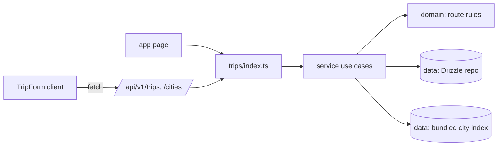
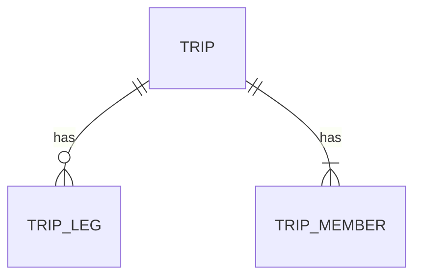

# Plan: Create a trip by drawing its route, and see it on home

Redesign note (2026-11-02): UI rows below follow the metro line world
(DESIGN.md, `RouteLine` in `shared/ui`). Domain, service, API and data
decisions are unchanged.

Feature: ./feature.md
Issue: #5
Status: approved

## Context

- `src/modules/trips` exists from #3 with a mocked `InMemoryTripsReader`
  (email suffix `+trips`/`+pasttrips`), `getHomeTripsSummary`, a
  `HomeScreen` and an `EmptyTripsState`. No trip tables.
- `src/app/[locale]/trips/new/page.tsx` is a placeholder.
- `getCurrentUser()` (`@/modules/auth`) gives `id`, `email`.
- This feature replaces the mock with real storage and changes #3's
  past-only behavior (past trips now show in "Other trips"). Three #3
  scenarios are edited in T01 (D-6).

## Architecture

| Path (under `src/` unless tooling) | Layer   | Purpose                   |
| ---------------------------------- | ------- | ------------------------- |
| `trips/domain/route.ts`            | domain  | legs, validation (new)    |
| `trips/domain/route-view.ts`       | domain  | stops from legs (new)     |
| `trips/domain/current-stop.ts`     | domain  | current stop (new)        |
| `trips/domain/trip.ts`             | domain  | legs, version (changed)   |
| `trips/service/*`                  | service | use cases, ports          |
| `trips/data/drizzle-trips-repo...` | data    | replaces in-memory reader |
| `trips/data/city-index.ts`         | data    | city search (new)         |
| `trips/data/cities.json`           | data    | generated en + es names   |
| `trips/ui/form/*`                  | ui      | form, combobox (new)      |
| `trips/ui/home/*`                  | ui      | trip line, panels (new)   |
| `shared/db/schema/trips.ts`        | shared  | tables below (new)        |
| `app/api/v1/{trips,cities}/**`     | app     | thin handlers (new)       |
| `app/[locale]/trips/{new,[tripId]}`| app     | pages                     |
| `scripts/build-cities.ts`          | tooling | regenerates cities.json   |

`destinations` module is removed from the architecture table (ADR 0009).

## Data model

- `trip`: `id` text pk (uuid), `name` text (1-60), `currency` text
  (ISO 4217), `version` int default 1, `created_at`, `updated_at`.
- `trip_member`: `trip_id` fk cascade, `user_id` fk cascade, `role`
  text (`owner` only now; `editor`/`viewer` in #6). pk (trip_id,
  user_id). Index on `user_id`.
- `trip_leg`: `id` text pk, `trip_id` fk cascade, `position` int
  (0-based), `from_city_id` text null, `from_code` text, `from_name`
  text, same three for `to_`, `date` text null (`YYYY-MM-DD`). Unique
  (trip_id, position).
- City id null = free text (feature 4a); `code` = first 3 letters.
- Save replaces all legs of a trip in one transaction.

## Contracts

Zod schemas in `trips/service/schemas.ts`, exported via
`trips/ui/index.ts` (types + schemas) for the form.

`TripInput`: `{ name, currency, legs: LegInput[] }` (1-10 legs).
`LegInput`: `{ from: CityRef, to: CityRef, date: string | null }`.
`CityRef`: `{ cityId: string | null, code: string, name: string }`.
`TripDto`: `{ id, name, currency, version, role, memberCount,
startDate | null, endDate | null, legs: LegDto[] }`; `LegDto` =
`LegInput` with `name` localized to the request locale.

| Method + path                 | Body / query          | 2xx            |
| ----------------------------- | --------------------- | -------------- |
| POST `/api/v1/trips`          | `TripInput`           | 201 `TripDto`  |
| GET `/api/v1/trips`           | `?cursor&limit≤20`    | 200 page (1)   |
| GET `/api/v1/trips/:id`       | -                     | 200 `TripDto`  |
| PATCH `/api/v1/trips/:id`     | `TripInput & {version}` | 200 `TripDto`|
| DELETE `/api/v1/trips/:id`    | -                     | 204            |
| GET `/api/v1/cities`          | `?q&locale`           | 200 cities (2) |

(1) `{ items: TripDto[], nextCursor }`. (2) `{ items: CityOption[] }`,
max 8, `q` ≥ 2 chars. `CityOption`: `{ cityId, code, name, country }`
(name in `locale`).
Locale for trips endpoints: `Accept-Language` matched to `en`/`es`.

Errors (`{ error: { code, message } }`):

| HTTP | `error.code`             | When                             |
| ---- | ------------------------ | -------------------------------- |
| 400  | `VALIDATION_FAILED`      | Zod fails; `details` per field   |
| 400  | `ROUTE_INVALID`          | domain rule fails; `details`     |
|      |                          | `[{ legIndex, rule }]`           |
| 401  | `UNAUTHENTICATED`        | no session                       |
| 404  | `TRIP_NOT_FOUND`         | missing or caller not a member   |
| 403  | `TRIP_FORBIDDEN`         | member but not owner (edit/del)  |
| 409  | `TRIP_VERSION_CONFLICT`  | `version` stale                  |

Route rules (`RouteRule`): `SAME_CITY`, `DATE_ORDER`, `DATE_PAST`
(create only; on update only new or changed dates), `TOO_MANY_LEGS`,
`NO_LEGS`.

Exported signatures (T01 owns, others consume):
- `validateRoute({ legs, today, previousLegs? }): RouteViolation[]`
- `stopsFromLegs(legs): RouteView` → `{ takeoff, stops[], backHome }`
- `currentStopIndex({ view, today }): number | null`
- `daysBetween({ from, to }): number`
- `trips/index.ts`: `createTrip`, `getTrip`, `listMyTrips`,
  `updateTrip`, `deleteTrip`, `searchCities`, `getHomeTrips`
  (all take `{ userId, locale, today, ... }`).

## UI components

| Component        | Location               | Purpose                       |
| ---------------- | ---------------------- | ----------------------------- |
| `TripForm`       | `trips/ui/form/`       | create and edit, route line   |
| `LegFields`      | `trips/ui/form/`       | one leg row                   |
| `CityCombobox`   | `trips/ui/form/`       | WAI-ARIA combobox, `/cities`  |
| `CurrencySelect` | `trips/ui/form/`       | ISO list, locale default      |
| `TripLine`       | `trips/ui/home/`       | vertical / horizontal line    |
| `StopStation`    | `trips/ui/home/`       | one stop on the line          |
| takeoff / home   | `RouteLine` hub stops  | filled-ring start and end     |
| `CompactTrip`    | `trips/ui/home/`       | other trips (Panel)           |
| `HomeScreen`     | `trips/ui/components/` | changed: uses the above       |

## Naming

| Concept           | Name in code            | Notes                      |
| ----------------- | ----------------------- | -------------------------- |
| leg               | `Leg`, `trip_leg`       | feature.md "Concepts"      |
| stop / origin     | `Stop`, `origin`        | derived, never stored      |
| start / end cards | `Takeoff`, `BackHome`   | match copy                 |
| home read         | `getHomeTrips`          | replaces `getHomeTripsSummary` |
| pages             | `/trips/new`, `/trips/[tripId]` | edit page = trip page |

i18n: `trips.*`, split files
`messages/<locale>/{home,form,city,cards,edit}.json` (`cards` holds
the station copy; name kept so T01 files stay valid)
(ADR 0008), created in T01.

## Performance budgets

| Metric                        | Budget   | How measured                 |
| ----------------------------- | -------- | ---------------------------- |
| Home queries                  | ≤ 2      | integration test (trips + legs) |
| `/cities` p95                 | ≤ 50 ms  | in-memory index, unit timing |
| Trip write p95                | ≤ 400 ms | 1 transaction                |
| JS `/trips/new` (gzip)        | ≤ 170 KB | Lighthouse CI; no city data  |
| Home LCP / CLS                | 2.5 s / 0.1 | Lighthouse CI; line SSR'd  |
| Combobox keystroke            | debounce 150 ms, abort stale | unit test |

## Accessibility notes

- `CityCombobox`: APG "Combobox with listbox popup", `aria-activedescendant`.
- `TripLine`: `region` "Trip stops" + `ol`; a horizontal line that
  overflows is a keyboard-scrollable region (no roving tabindex; APG
  carousel is not used, no
  auto-rotation).
- Live region in `TripForm` for leg added/removed and save result.
- Dialogs (`Dialog` from `shared/ui`) for discard and delete.

## Decisions

### D-1. City data: OurAirports + GeoNames, server-side, en + es names
Chosen: script joins OurAirports (public domain, airports with
scheduled service) to GeoNames `cities1000` + alternate names (CC BY
4.0, attribution in README) → `cities.json` `{ id, code, country,
names: { en, es } }`, committed. Searched in memory on the server.
Alternatives: client bundle (blows JS budget), external API (cost).
Why: user decision; no runtime dependency.

### D-2. Legs live in `trips` (ADR 0009)
Route is saved atomically with the trip; stops derive from legs.

### D-3. Localize names at read time
Stored `name` is the fallback; when `cityId` is set, the DTO name
comes from `cities.json` in the request locale.

### D-4. REST + fetch, no Server Actions
Public API needed anyway; form is a client component.

### D-5. Today = user's local date
Client sets a `tz` cookie (IANA) once; server computes `today` in that
zone, fallback UTC. Countdown and current stop SSR without shift.

### D-6. #3 tests edited
`InMemoryTripsReader` deleted. #3 scenarios seed real trips via a
step helper; the past-only example of #3's empty-state outline is
removed (now covered by this feature's past-trips scenario). Commit
`test(trips): ...` with the reason.

### D-7. Own combobox, hard delete
No new runtime dependency. Delete cascades legs and members.

### D-8. Currency default
Region from `navigator.language` → currency via a small bundled
region map in `trips/ui/form`; names via `Intl.DisplayNames`; list via
`Intl.supportedValuesOf("currency")`.

## Risks

- GeoNames join misses cities: free-text fallback still works.
- `tz` cookie absent on first SSR: one render in UTC; acceptable.
- Concurrent writes on SQLite: version check inside the transaction.
- #3 i18n date-range scenario: keep the next-trip date range in the
  line header so it still passes.

## Left to implementation

- Line visuals (DESIGN.md metro line), takeoff/back-home hubs: T04
- Exact copy (en, es) per message file: owning task
- City ranking (prefix match, then population): T02
- Region→currency map contents: T01
- Combobox debounce/abort implementation details: T02
- Desktop grid breakpoints: T04
