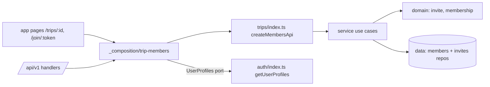
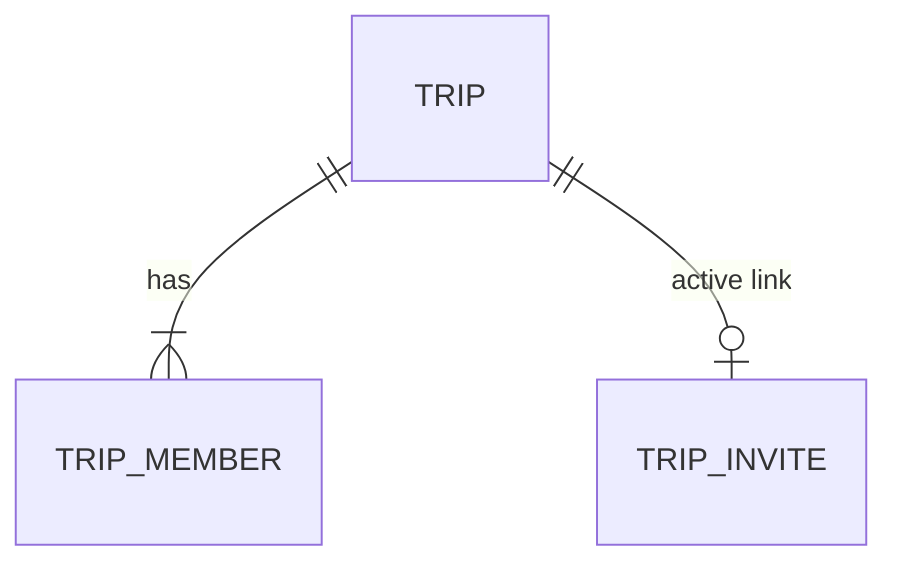

# Plan: Invite friends to a trip by link

Feature: ./feature.md
Issue: #9
Status: approved

## Context

- `trips` module (#5): `trip`, `trip_member` (role enum `owner` only),
  `trip_leg`. Use cases `getTrip`, `updateTrip`, `deleteTrip` check
  `role === "owner"` for edit and delete. `TripDto.role` is `"owner"`.
- Trip page `app/[locale]/trips/[tripId]/page.tsx` renders `TripForm`;
  non-members get `notFound()`.
- Auth (#3): `getCurrentUser()`; magic link via `useRequestMagicLink`
  (plain `fetch`, no `callbackURL` today). Name capture lives on `/`
  and its Server Action always redirects to `/`.
- Better Auth magic link accepts `callbackURL` and redirects there
  after verify (checked in `node_modules/better-auth`).
- Toasts on home are driven by query params (`?created=1`).

## Architecture

| Path (under `src/`)                     | Layer   | New/Changed | Purpose                          |
| --------------------------------------- | ------- | ----------- | -------------------------------- |
| `modules/trips/domain/invite.ts`        | domain  | new         | expiry, token rules              |
| `modules/trips/domain/membership.ts`    | domain  | new         | role permissions, member cap     |
| `modules/trips/service/<use-case>.ts`   | service | new         | one file per use case (Naming)   |
| `modules/trips/service/ports.ts`        | service | changed     | `MembersRepository`, `InvitesRepository`, `UserProfiles`, `TokenGenerator` |
| `modules/trips/data/drizzle-members-repository.ts` | data | new   | list, add (capped), remove       |
| `modules/trips/data/drizzle-invites-repository.ts` | data | new   | active link per trip, by token   |
| `modules/trips/index.ts`                | index   | changed     | `createMembersApi(deps)`         |
| `modules/trips/ui/members/*`            | ui      | new         | Travelers card, Invite card      |
| `modules/trips/ui/join/*`               | ui      | new         | join preview, expired, full      |
| `modules/auth/index.ts`                 | index   | changed     | `getUserProfiles`                |
| `modules/auth/ui/*`                     | ui      | changed     | magic link form with callback    |
| `app/_composition/trip-members.ts`      | app     | new         | wires auth profiles into trips   |
| `app/_composition/api-errors.ts`        | app     | new         | shared error → status mapping    |
| `app/[locale]/join/[token]/page.tsx`    | app     | new         | join page                        |
| `app/[locale]/join/[token]/accept/route.ts` | app | new         | post-sign-in join + redirect     |
| `app/api/v1/trips/[tripId]/{members,invite}/**` | app | new     | thin handlers                    |
| `app/api/v1/invites/[token]/**`         | app     | new         | preview, join                    |

## Data model

- `trip_member.role`: enum `owner | editor`. New `joined_at`
  (timestamp ms, not null; migration backfills from `trip.created_at`).
- `trip_invite` (new): `trip_id` pk + fk cascade (one active link per
  trip), `token` text unique, `created_at`, `expires_at`.
  Reset = replace the row in one statement; the old token is gone.
- Token: 32 random bytes, base64url (43 chars). Stored as is (D-2).
- Join inserts with `INSERT ... SELECT ... WHERE (count) < 20` so the
  cap holds under concurrent joins (EC-3) without a read-then-write.
- One migration, generated in T01.

## Contracts

Types in `trips/service/schemas.ts`:
- `TripDto.role`: `"owner" | "editor"`.
- `MemberDto`: `{ userId, name, email, role, joinedAt }` (ISO).
- `InviteDto`: `{ url, expiresAt }` (url absolute, `/join/<token>`,
  no locale prefix so the visitor's locale applies, EC-9).
- `InvitePreviewDto`: `{ tripName, ownerName, startDate | null,
  endDate | null, memberCount }`.
- `JoinResultDto`: `{ tripId, alreadyMember: boolean }`.

| Method + path                              | Who     | 2xx                      |
| ------------------------------------------ | ------- | ------------------------ |
| GET `/api/v1/trips/:id/members`            | member  | 200 `{ items: MemberDto[] }` (≤ 20, owner first, then `joinedAt`) |
| DELETE `/api/v1/trips/:id/members/:userId` | owner (other), editor (self = leave) | 204 |
| POST `/api/v1/trips/:id/invite`            | owner   | 200 `InviteDto` (get or create) |
| POST `/api/v1/trips/:id/invite/reset`      | owner   | 200 `InviteDto` (new token, new expiry) |
| GET `/api/v1/invites/:token`               | anyone  | 200 `InvitePreviewDto`   |
| POST `/api/v1/invites/:token/join`         | signed in | 200 `JoinResultDto`    |
| PATCH `/api/v1/trips/:id`                  | owner, editor (changed) | as #5   |

New error codes (`{ error: { code, message } }`):

| HTTP | `error.code`              | When                                  |
| ---- | ------------------------- | ------------------------------------- |
| 403  | `TRIP_FORBIDDEN`          | editor calls owner-only action        |
| 403  | `OWNER_CANNOT_LEAVE`      | owner DELETEs own membership          |
| 404  | `MEMBER_NOT_FOUND`        | `:userId` not in trip                 |
| 410  | `INVITE_EXPIRED`          | token expired, reset, unknown, or trip deleted |
| 409  | `TRIP_FULL`               | trip has 20 members                   |

Non-members keep getting `404 TRIP_NOT_FOUND` from the API (no leak).

Exported signatures (T01 owns, others consume):
- `trips/index.ts`: `createMembersApi({ profiles: UserProfiles })`
  returns `listTripMembers`, `getOrCreateInvite`, `resetInvite`,
  `getInvitePreview`, `joinTrip`, `removeMember`, `leaveTrip`
  (all take an object: `{ userId?, tripId?, token?, now, ... }`).
- `getTripAccess({ userId, tripId })` → `"member" | "not-member" |
  "missing"` (page uses it for the removed redirect, D-4).
- `UserProfiles.getMany(userIds): Promise<{ id, name, email }[]>`
  (one query); auth exports `getUserProfiles` matching it.
- `app/_composition/trip-members.ts` exports `tripMembers` (the
  configured API). Pages and handlers import from there.
- `isExpired({ invite, now })`, `canManageMembers(role)`,
  `MAX_MEMBERS = 20`, `INVITE_TTL_DAYS = 7` in domain.

## UI components

| Component         | Location                  | Purpose                        |
| ----------------- | ------------------------- | ------------------------------ |
| `TravelersCard`   | `trips/ui/members/`       | floating card / mobile bar     |
| `MemberRow`       | `trips/ui/members/`       | name, badge, Remove / Leave    |
| `InviteCard`      | `trips/ui/members/`       | popover (desktop), sheet (mobile) |
| `JoinScreen`      | `trips/ui/join/`          | preview + Join or sign-in slot |
| `InviteExpiredScreen`, `TripFullScreen` | `trips/ui/join/` | error states |
| `MagicLinkForm`   | `auth/ui/components/`     | email form with `callbackURL`, extracted from `LandingScreen` |

`JoinScreen` takes the sign-in form as a slot (children) so trips UI
never imports auth UI; the join page composes them.
Entry `trips/ui/entries/members.ts` for Travelers + Invite cards.

## Naming

| Concept            | Name in code                 | Notes                     |
| ------------------ | ---------------------------- | ------------------------- |
| invite link        | `Invite`, `trip_invite`      | one per trip              |
| member             | `Member`, `MemberDto`        | owner or editor           |
| roles              | `owner`, `editor`            | no viewer                 |
| travelers card     | `TravelersCard`              | copy says "Travelers"     |
| join page          | `/join/[token]`              | under `[locale]`          |
| post-sign-in join  | `/join/[token]/accept`       | GET route handler         |
| toast params       | `?joined=1`, `?already=1` (trip page); `?left=1`, `?removed=1` (home); `?invite=1` opens Invite card | |

i18n: `trips.members`, `trips.invite`, `trips.join` (new files under
`trips/messages/<locale>/`, created in T01). New error messages go in
`trips.errors` (T01).

## Performance budgets

| Metric                          | Budget    | How measured                   |
| ------------------------------- | --------- | ------------------------------ |
| Members list queries            | ≤ 2       | integration test (members + profiles) |
| Trip page queries added         | ≤ 2       | integration test               |
| Join write p95                  | ≤ 400 ms  | single statement               |
| Invite preview p95              | ≤ 200 ms  | ≤ 2 queries, integration test  |
| JS `/join/[token]` (gzip)       | ≤ 170 KB  | Lighthouse CI                  |
| JS trip page added by members entry | ≤ 15 KB | build output                  |
| CLS trip page                   | ≤ 0.1     | Lighthouse CI; card space SSR'd |

## Accessibility notes

- `TravelersCard`: `region` "Travelers", `ul`. Mobile: disclosure
  button with `aria-expanded`.
- `InviteCard`: desktop non-modal popover (Escape/✕ close, focus back
  to "Invite"); mobile modal `Dialog` bottom sheet, focus trapped.
- Read-only link `Input` labeled "Invite link", selects on focus.
- One polite live region in `TravelersCard` for Copied / removed /
  reset.
- Confirms use `Dialog` from `shared/ui`; focus returns to trigger or
  Travelers heading.

## Decisions

### D-1. Separate members API built in the app layer
Chosen: `createMembersApi({ profiles })` wired in `_composition`.
Alternatives: trips querying the `user` table (breaks table
ownership); duplicating names in `trip_member` (stale on rename).
Why: architecture.md "Crossing modules", port option 1.

### D-2. Token stored in plain text
Chosen: plain, unique index. Alternative: store a hash.
Why: the owner must see the link again in the Invite card; it is a
capability the owner shares anyway. Reset revokes it.

### D-3. Post-sign-in join via `accept` route handler
Signed-out visitors request the magic link with `callbackURL =
/<locale>/join/<token>/accept`. The handler joins and redirects to the
trip page with a toast param, or to the expired/full page. If the
user needs a name, it redirects to `/?next=<accept path>`; the name
capture action honors `next` (relative paths only, starts with `/`,
not `//`). Alternative: auto-join in the page render (prefetch can
trigger it). Better Auth `newUserCallbackURL` not used: name capture
is our flag, not Better Auth's.

### D-4. Removed members go home
Trip page: `getTripAccess` = `not-member` → redirect home `?removed=1`;
`missing` → existing not-found. `TripForm` on PATCH 404 does the same
(EC-5). API still answers 404.

### D-5. Editors edit, owners manage
`updateTrip` allows `owner` and `editor`; `deleteTrip`, invite and
remove stay owner-only via `canManageMembers`. Version conflict as #5.

### D-6. product.md updated
Viewer role and role picker removed from `docs/product.md`
(feature.md "Users and roles"). Done in T01.

### D-7. No new dependencies
Clipboard API, Web Share API, `navigator.onLine` are platform.

## Risks

- Concurrent joins on SQLite: single guarded `INSERT ... SELECT`;
  integration test runs two joins at 19 members.
- Magic link `callbackURL` open redirect: only our own relative path
  is built server-side; `next` validated (D-3).
- Shared `index.ts`/messages across tasks: T01 creates stubs and empty
  files so later tasks only edit their own files.
- Clipboard blocked in tests: e2e grants clipboard permissions in the
  copy scenario's step.

## Left to implementation

- Card visuals per DESIGN.md metro line world, mobile breakpoints: T01, T02
- Exact copy en/es in each message file: owning task
- Offline hook shape (`useIsOnline`): T07
- Toast with "Invite friends" action layout: T07
- Popover positioning: T02
