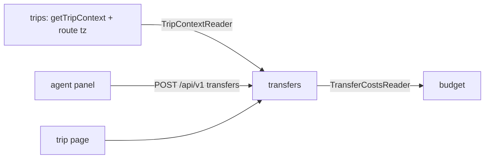
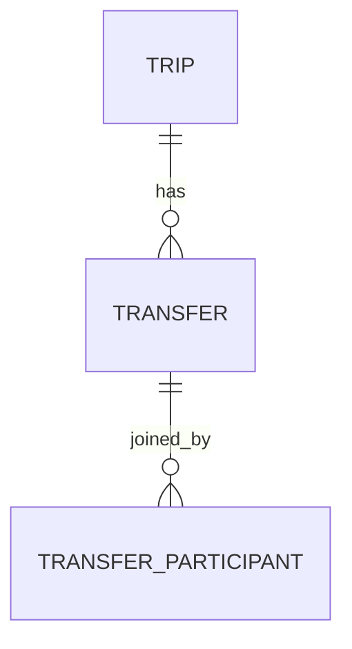

# Plan: Transfers between destinations

Feature: ./feature.md
Issue: #15
Status: approved

## Context

- Route = `trip_leg` rows in `trips` (ADR 0009). Leg `g` goes from
  `from` to `to` on `date`. Stops are derived; no return leg unless the
  user adds one.
- Flights are `budget_item` rows with `category = flights`, per person
  via `userId`, placed by `stop` (leg position).
- Trip page `src/app/[locale]/trips/[tripId]/page.tsx` renders one
  `StopAccordion` per stop. Gaps will render between them.
- Agent approves suggestions through `/api/v1` (ADR 0010).
- `cities.json` has no time zones. `scripts/build-cities.ts` reads
  GeoNames `cities15000`, which has a timezone column.

## Architecture

New module `transfers` (ADR 0011). Data flows through ports wired in
`src/app/_composition/trip-context.ts`.

| Module                         | Layer | New | Purpose                   |
| ------------------------------ | ----- | --- | ------------------------- |
| `transfers/domain`             | dom   | yes | Transfer, gaps, duration  |
| `transfers/service`            | svc   | yes | use cases, ports, Zod     |
| `transfers/data`               | data  | yes | Drizzle repository        |
| `transfers/ui`                 | ui    | yes | gap, card, sheet, next up |
| `trips` (index, city-index)    | data  | no  | route with tz in context  |
| `budget` (domain, service, ui) | all   | no  | transfers category, port  |
| `agent`                        | all   | no  | transfer suggestion       |
| `shared/ui/transfer-events.ts` | ui    | yes | client events             |
| `shared/db/schema/transfers.ts`| db    | yes | tables                    |

## Data model

`transfer`: `id` text pk; `trip_id` fk cascade; `gap` int; `mode` enum
(flight, train, bus, ferry, car, other); `from_name`, `to_name` text
(snapshot); `depart_date` text `YYYY-MM-DD` not null; `depart_time`
`HH:MM` null; `depart_tz` IANA null; `arrive_date`, `arrive_time`,
`arrive_tz` null; `cost` int minor null; `currency`, `rate` text null;
`charge` enum (all, opt-in); `booking_ref`, `link`, `notes` text null;
`needs_review` int bool default 0; `version` int default 1;
`created_by` fk user; `created_at` ms. Index `(trip_id)`.

`transfer_participant`: `transfer_id` fk cascade, `user_id` fk
cascade, pk both.

Times are local wall-clock in their tz (i18n standard: travel events
display in the place's zone). Instants are derived in the domain.

Migration (T03, hand-written SQL in the generated file): each
`budget_item` with `category = 'flights'` becomes a transfer: mode
flight, gap = `stop` (null → 0, `needs_review = 1`), names from the
leg at that position, `depart_date` = leg date, else the item's
`created_at` day with `needs_review = 1`, `notes` = label, cost,
currency, rate, link kept; `user_id` set → `charge = opt-in` plus a
participant row; else `all`. Then the flight items are deleted.

## Contracts

### Gaps (domain, T01)

`gapsOf(route) → Gap[]`. `Gap = { index, kind: outbound | between |
return, from: GapCity | null, to: GapCity | null, date: string |
null, window: { from: string | null, to: string | null } }`.
`GapCity = { name, code, tz: string | null }`. Gap `g < legs.length`
is leg `g` (kind outbound for 0). A return gap (index `legs.length`,
from last stop to origin) exists when the last leg does not end at the
origin. Window: previous leg date to this leg date, inclusive.

### TripContextReader (port of transfers, T01)

`get(tripId, userId, locale) → { currency, memberIds, route: { legs:
{ from: GapCity, to: GapCity, date }[] } } | null`. Provided by
`getTripContext` in `trips/index.ts`, extended with `route`.

### TransferDto (T01)

`{ id, gap, mode, from, to, departDate, departTime, departTz,
arriveDate, arriveTime, arriveTz, durationMinutes | null, dayOffset
(0, 1, 2…), cost | null, currency | null, costInTripCurrency | null,
charge, participantIds, bookingRef, link, notes, needsReview,
routeChanged, isPast, outsideWindow, version }`.

`GET /api/v1/trips/{tripId}/transfers` → `{ currency, gaps: Gap[],
transfers: TransferDto[] }`, sorted by gap, then depart date/time,
then created.

### POST /api/v1/trips/{tripId}/transfers (T01)

Body `transferInputSchema`: `{ gap, mode, from, to, departDate,
departTime?, departTz?, arriveDate?, arriveTime?, arriveTz?, cost?
(major units), currency?, rate?, charge, bookingRef?, link?, notes?
}`. 201 → `TransferDto`.

### PATCH / DELETE `/api/v1/trips/{tripId}/transfers/{transferId}` (T02)

PATCH body = input + `version`. 200 → `TransferDto`. DELETE → 204.

### PUT / DELETE `.../transfers/{transferId}/participation` (T04)

Join / leave as the caller. 204. 400 `TRANSFER_NOT_OPT_IN` on an
"all" transfer.

Errors (all added by T01 to `api-errors.ts` and `trips` errors.json):

| Code | When                              | `error.code`              |
| ---- | --------------------------------- | ------------------------- |
| 400  | Zod fails                         | VALIDATION_FAILED         |
| 400  | arrival before departure          | TRANSFER_ARRIVAL_BEFORE   |
| 400  | join an "all" transfer            | TRANSFER_NOT_OPT_IN       |
| 404  | not a member / no trip            | TRIP_NOT_FOUND            |
| 404  | no transfer                       | TRANSFER_NOT_FOUND        |
| 409  | `version` stale                   | TRANSFER_VERSION_CONFLICT |
| 409  | more than 50 transfers per trip   | TOO_MANY_TRANSFERS        |

### TransferCostsReader (port of budget, T03)

`forTrip(tripId) → { id, gap, label, cost (trip minor), charge,
participantIds }[]`. Exported by transfers as `transferCosts`.

### Client events (T01, `shared/ui/transfer-events.ts`)

`openTransferSheet({ gap, prefill? })` and `askAssistantForGap({ gap,
from, to, date })`, with matching `on…` subscribe functions returning
an unsubscribe. Window `CustomEvent` underneath.

### Agent suggestion (T05)

`TransferSuggestion = { kind: transfer, gap, mode, departDate,
departTime, arriveDate, arriveTime, cost, currency, sourceUrl }`.
`BudgetSuggestion.category` loses `flights`.

## UI components

| Component            | Purpose (all in `transfers/ui/components`) | Task |
| -------------------- | ------------------------------------------ | ---- |
| `TransferGap`        | empty slot or list of a gap                | T01  |
| `TransferCard`       | one transfer, read view, edit/delete       | T01  |
| `TransferSheetHost`  | add/edit sheet, listens to events          | T02  |
| `JoinTransferToggle` | Join / Joined, "n of m"                    | T04  |
| `NextTransferCard`   | "Next up" on the trip page                 | T06  |

Budget card gains a Transfers group (T03).

Client entry: `transfers/ui/entries/transfers.ts`.

## Naming

| Concept               | Name in code              | Notes                     |
| --------------------- | ------------------------- | --------------------------|
| transfer              | `Transfer`                | never "flight" or "leg"   |
| mode                  | `TransferMode`            | `flight` … `other`        |
| charge mode           | `ChargeMode`              | `all`, `opt-in`           |
| gap                   | `Gap`, `gap` (index)      | not `stop`                |
| use cases             | see below                 | one file each             |
| next transfer         | `nextTransfer`            | domain, T06               |
| tables                | `transfer`, `transfer_participant` | |
| budget category       | `transfers`               | replaces `flights`        |

Use cases: `listTransfers`, `createTransfer`, `updateTransfer`,
`deleteTransfer`, `setTransferParticipation`, `transferCosts`.

i18n namespace: `transfers.*` (`gap`, `card`, `form`, `next`); error
copy in `trips.errors`.

## Performance budgets

| Metric                          | Budget        | How measured            |
| ------------------------------- | ------------- | ----------------------- |
| `listTransfers` queries         | ≤ 2 + context | repository integration  |
| `transferCosts` queries         | ≤ 2           | repository integration  |
| GET transfers p95               | ≤ 200 ms      | standard                |
| Write p95                       | ≤ 400 ms      | standard                |
| Trip page JS added              | ≤ 15 KB gzip  | build output, lhci      |
| CLS (next up is server-rendered)| ≤ 0.1         | lhci                    |

Sheet and form load via the client entry only on the trip page.

## Accessibility notes

- Sheet: Radix Dialog (focus trap, Escape, return focus to trigger).
- Card: one `aria-label` sentence (feature "Accessibility"); icons
  `aria-hidden`.
- Join toggle: button with `aria-pressed`.
- Countdown: plain text, no live region.
- After save focus goes to the saved card; after delete to the next
  card or the gap's "+ Add".

## Decisions

### D-1. New `transfers` module (ADR 0011)

Chosen: own module. Alternatives: inside `trips`, inside `budget`.
Why: has participants, costs and times; trips is already large and
budget is about money only. Chosen by the owner.

### D-2. Gap by index plus name snapshot

Chosen: `gap` int + `from_name`/`to_name`. Alternatives: fk to
`trip_leg.id` (legs are rewritten on save, ids change). Why: matches
`budget_item.stop`; snapshot gives the "Route changed" flag (EC-1).

### D-3. Local time + tz per end

Chosen: local date/time + IANA tz columns. Alternatives: UTC instants.
Why: what users enter and read is local; duration and ordering derive
instants in the domain with `Intl`. No date library.

### D-4. City time zones from GeoNames

Chosen: `tz` per city in `cities.json` via `build-cities.ts`. Free
text cities: the form asks, defaulting to the browser zone. Chosen by
the owner.

### D-5. Remove `flights` category, migrate data

Chosen: drop it; breaking for the budget API. Chosen by the owner.

### D-6. Cross-module UI through window events

Chosen: tiny `shared/ui/transfer-events.ts`. Alternatives: React
context in `shared` (page would need a provider for both modules).
Why: "Find options" (transfers) opens the agent; "No options → Add"
(agent) opens the transfer sheet; modules cannot import each other.

### D-7. "Find options" sends a prefilled prompt

The agent panel opens and sends a localized prompt naming the gap
(from, to, date). Hidden when the agent is disabled.

### D-8. Next up on trip page only

Chosen by the owner. Uses the first transfer with depart instant
after now; date-only transfers count until their day ends.

### D-9. No new dependency.

## Risks

- Untracked `src/shared/db/migrations/0006_amusing_darwin.sql` (not in
  the journal) collides with the next migration number: the owner
  removes it before T01. `src/shared/ui/duration.ts` (untracked) is
  reused for durations; T01 commits it.
- GeoNames download in T01 needs network: if it fails, T01 is blocked,
  not stubbed.
- Gap index drifts on route reorder: flagged, never auto-moved.
- DST: duration computed from instants per zone; unit tests cover a
  DST change and a date-line crossing (T02).

## Left to implementation

- Exact copy, icons per mode, card layout: T01, T02.
- Time zone picker UI for free-text cities: T02.
- Countdown wording rules (today, tomorrow, in n days, hours): T06.
- Agent prompt wording and tool schema details: T05.
- Transfers group layout in budget card: T03.
- Rate entry UI reuses the budget form pattern: T02.
